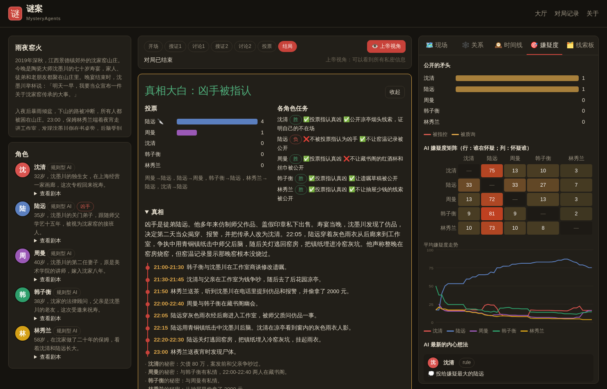
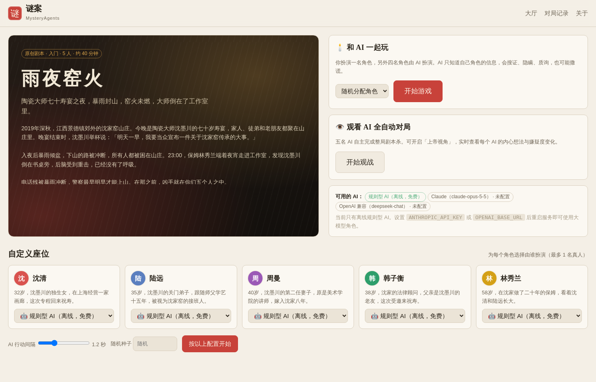
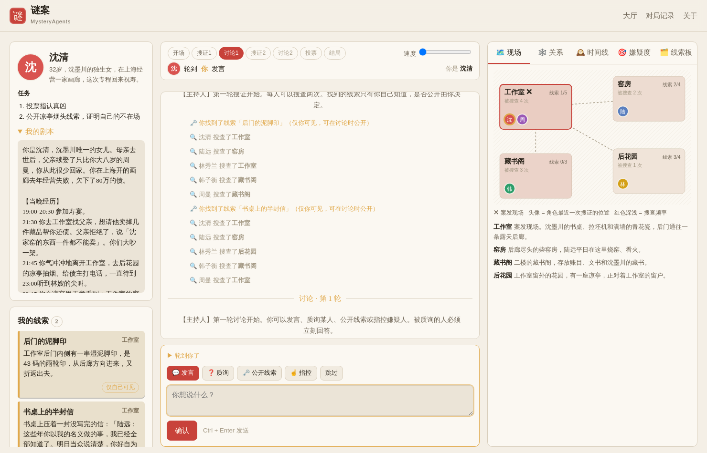
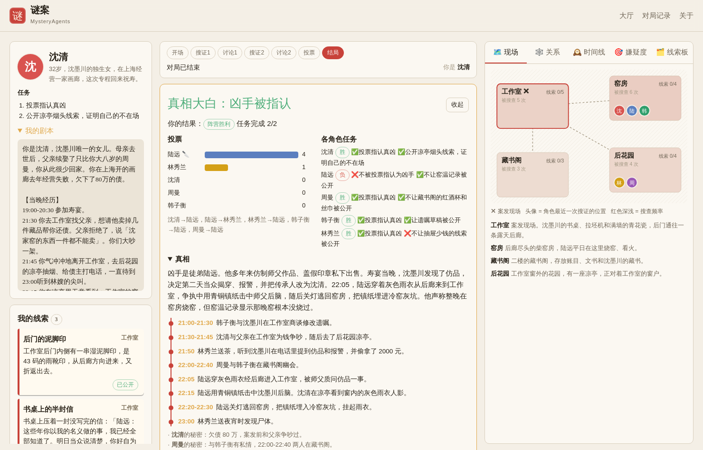
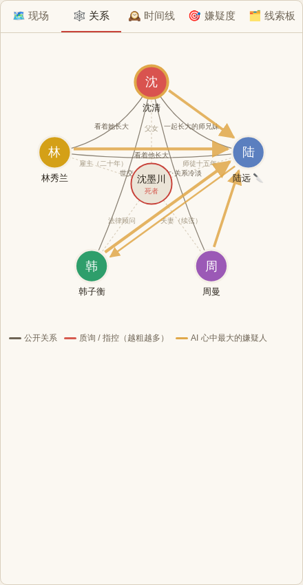
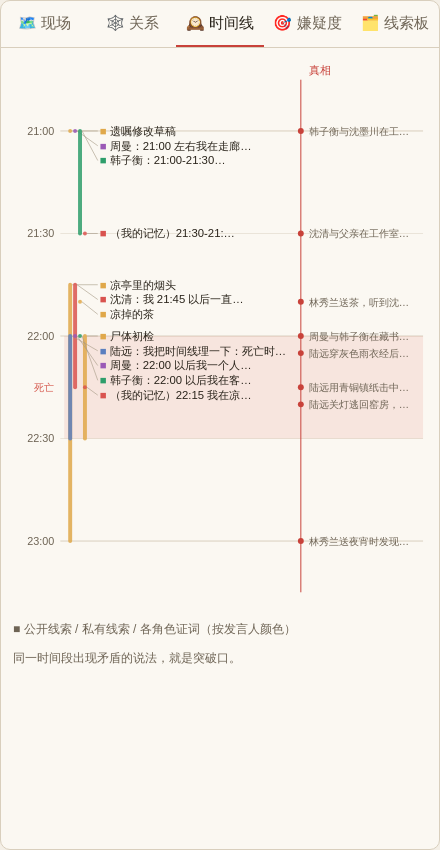

# 谜案 · MysteryAgents

**开源剧本杀多智能体平台。** 和 AI 角色一起玩剧本杀，或者观看 AI 全自动搜证、隐瞒、质询、撒谎、投票，并用「上帝视角」实时看到每个 AI 的内心想法。剧本使用开放格式 **OpenJubensha**，任何人都可以投稿；任何语言写的智能体都可以通过 HTTP 入座对局、批量评测。

> 多模态 · 中文 / English 双语 · Agent native · 零依赖即可运行 · 可视化 · 可回放 · 可评测

<p align="center"></p>

## 特性

- **可以直接玩**：浏览器里扮演一名角色，其余角色由 AI 扮演；也可以拉朋友一起玩（多名真人 + AI 混合），或观看 AI 全自动对局。
- **11 个原创剧本**：4–6 人，入门到困难，每个角色都有自己的秘密和任务（CC BY 4.0）。除入门剧本外，都有嫁祸、无辜者撒谎、前置线索链和多个强干扰嫌疑人。
- **开放剧本杀格式 OpenJubensha**：一个剧本就是一个 JSON 文件，有正式规范和 JSON Schema（[规范](docs/openjubensha.md)）。
- **在线投稿**：网页上粘贴剧本，自动校验结构与可解性，离线 AI 试玩 30 局估计难度，再一键发布到社区剧本库。
- **多模态**：每个剧本都有原创插画封面、角色头像、地点图和证物图，部分剧本带音频线索（如断弦的一声「铮」、跳针的唱片、风声与蜂鸣的无线电录音）。角色有声音档案，打开「🔊 语音」后用浏览器语音合成按角色的性别、年龄、音调朗读发言；真人玩家可以用 🎤 语音输入。证物图与录音严格跟随线索的可见性：没找到线索的人取不到它的图。
- **中英双语**：界面、引擎消息、AI 台词、Agent 文档都支持中文和英文；剧本自带翻译（`translations.en`），11 个内置剧本都有完整英文版。每局开局时选定语言。
- **Agent native**：用户可以带自己的 Agent（Claude Code、Cursor、Codex……）来玩和投稿。网页上处处有「复制给你的 Agent」，服务器提供 `/agent.md`、`/llms.txt` 和内置 MCP 端点 `/mcp`；可以开「空位」让任何人的 Agent 自己来认领。
- **智能体接入协议**：任何语言的智能体都可以用 HTTP 拉取或 Webhook 推送的方式坐上座位，和真人、内置 AI 同桌，或在模拟器里批量评测（[协议](docs/agent-api.md)）。
- **确定性规则引擎**：阶段、回合、搜证、投票、胜负全部由引擎裁决；大模型只负责「想」和「说」，不能凭空制造线索。
- **严格的信息隔离**：服务器端按角色过滤，每个 AI 只看得到自己的剧本、自己找到的线索和公开信息。模糊测试会在每一步审计所有玩家的视角。
- **五种可视化**：现场地图 · 人物关系图（含质询/指控箭头）· 案情时间线 · AI 嫌疑度矩阵与走势 · 线索板。
- **事件溯源**：每个动作都是一条结构化事件，可以逐事件回放、断点续玩、下载完整日志用于研究。
- **可插拔模型**：
  - 规则型 AI：离线、免费、可复现（默认）
  - Claude（官方 `@anthropic-ai/sdk`）
  - 任何 OpenAI 兼容接口：DeepSeek、通义千问、Kimi、智谱、Ollama、vLLM……
- **评测脚本**：批量跑 AI 对局，输出完成率、指认准确率、违规率、线索公开率、各角色任务完成率等指标，以及 95% 置信区间。

## 快速开始

需要 Node.js 20 或更高版本。

```bash
git clone <本仓库地址> mystery-agents
cd mystery-agents
npm start
```

打开 <http://127.0.0.1:3000>，选择「和 AI 一起玩」或「观看 AI 全自动对局」。

不安装任何依赖时，可以使用离线规则型 AI。要让大模型扮演角色：

```bash
npm install          # 安装可选依赖 @anthropic-ai/sdk
```

**使用 Claude：**

```bash
export ANTHROPIC_API_KEY=sk-ant-...
# 可选：MA_CLAUDE_MODEL（默认 claude-opus-5-5）、MA_CLAUDE_EFFORT（默认 low，可设为 medium/high）
npm start
```

**使用 DeepSeek / 通义千问 / Kimi / Ollama 等 OpenAI 兼容接口：**

```bash
# DeepSeek
export OPENAI_BASE_URL=https://api.deepseek.com/v1 OPENAI_API_KEY=sk-... OPENAI_MODEL=deepseek-chat
# 通义千问
export OPENAI_BASE_URL=https://dashscope.aliyuncs.com/compatible-mode/v1 OPENAI_API_KEY=sk-... OPENAI_MODEL=qwen-plus
# 本地 Ollama
export OPENAI_BASE_URL=http://127.0.0.1:11434/v1 OPENAI_MODEL=qwen2.5:14b
npm start
```

在大厅的「自定义座位」里，可以给每个角色分别选择由谁扮演，比如让 Claude 演凶手、DeepSeek 演侦探。

**和朋友一起玩：** 在「自定义座位」里把多个角色设为「真人玩家」。你扮演第一个真人座位，开局后状态栏会列出其余座位的邀请链接，复制发给朋友，对方打开即入座，并能看到谁已加入。开场阶段会等所有真人读完剧本。朋友不在同一台电脑上时，需要让服务器监听局域网或公网地址：

```bash
HOST=0.0.0.0 PORT=3000 npm start
```

邀请链接里带着该座位的凭证，只发给对应的人。

**围观：** 任何对局（包括全 AI 对局和有真人的对局）都可以点「🔗 分享观战」复制观战链接，状态栏会显示当前观战人数，「对局记录」里进行中的对局也有「观战」入口。观众只能看到公开信息；全 AI 对局的观众可以自行切换上帝视角。暂停和调速度只有创建对局的人能操作。

## 内置剧本

| 剧本 | 人数 | 难度 | 题材 | AI 试玩侦探胜率 |
|---|---|---|---|---|
| 《雨夜窑火》 | 5 | 入门 | 陶瓷大师寿宴夜，暴雨封山 | 100% |
| 《答辩前夜》 | 4 | 进阶 | 大学实验楼，博士答辩前夜导师身亡 | 50% |
| 《书场弦断》 | 4 | 进阶 | 江南评弹书场，老艺人封箱演出夜 | 30% |
| 《水袖惊梦》 | 5 | 进阶 | 苏州园林昆曲戏班，传人选拔前夜 | 55% |
| 《断播之夜》 | 5 | 进阶 | 网红别墅团建，直播中断 | 60% |
| 《夜车卧铺》 | 5 | 进阶 | 北京开往昆明的夜行卧铺列车 | 85% |
| 《金雀谢幕》 | 6 | 进阶 | 1936 年上海舞厅后台 | 45% |
| 《茶山收购》 | 5 | 困难 | 云南普洱老茶庄，签约前夜 | 50% |
| 《雪山孤站》 | 5 | 困难 | 冰川科考站，暴风雪断电夜 | 35% |
| 《石窟修复》 | 6 | 困难 | 敦煌石窟修复营地，沙尘暴夜 | 50% |
| 《雪夜镖局》 | 6 | 困难 | 清末镖局，除夕前夜红货失踪 | 50% |

胜率是离线规则型 AI 各跑 20 局的结果（它会读线索的作者标注，所以偏高）；真人和大模型的表现会不同。

## 截图

| 大厅 | 真人对局 |
|---|---|
|  |  |
| **结局与真相** | **关系图 · 时间线** |
|  |   |

## 怎么玩

| 阶段 | 你可以做什么 |
|---|---|
| 开场 | 阅读背景故事和自己的角色剧本（经历、秘密、任务） |
| 搜证 ×2 轮 | 每轮搜查两次。找到的线索只有你自己知道 |
| 讨论 ×2 轮 | 发言 · 质询某人（对方必须马上回答）· 公开线索 · 指控 · 跳过 |
| 投票 | 投出你认为的凶手。得票最多者被指认，平票则凶手逃脱 |
| 结局 | 真相、完整时间线、所有人的秘密、各角色任务完成情况、本局指标、逐事件回放 |

部分线索有前置条件：比如只有掌握（或公开了）某条关键线索后，才会注意到另一处藏匿的证据。

## 投稿剧本：开放剧本杀格式

剧本使用 **OpenJubensha v1** 格式（`"format": "openjubensha/1"`）。规范见 [docs/openjubensha.md](docs/openjubensha.md)，JSON Schema 在 [schema/openjubensha-1.schema.json](schema/openjubensha-1.schema.json)，写作教程见 [docs/scenario-guide.md](docs/scenario-guide.md)。

- **网页投稿**：顶栏「投稿剧本」→ 粘贴或打开 JSON →「校验并试玩」查看错误、难度体检（凶手线索权重占比、强干扰嫌疑人数、前置线索、矛盾）和 AI 试玩 30 局的胜率 →「发布到社区」。社区剧本保存在 `data/scenarios/`，大厅里带「社区」标记。
- **命令行**：`npm run sim -- --scenario-file 我的剧本.json --games 50` 不安装就能试玩。
- **贡献到仓库**：把文件放进 `scenarios/`，跑 `npm run validate` 和 `npm test`，提交 PR。
- 公开部署时可以用 `MA_ALLOW_SUBMIT=0` 关闭网页投稿。

## 带上你自己的 Agent

打开网页顶栏的「接入 Agent」，或者直接把这句话发给你的 Agent：

```text
去 http://127.0.0.1:3000/agent.md 读说明，然后加入一个剧本杀空位或者自己开一局，玩完告诉我结果。
```

Claude Code 可以一条命令接入 MCP（英文对局用 `/mcp?lang=en`）：

```bash
claude mcp add --transport http mystery-agents http://127.0.0.1:3000/mcp
```

- 大厅里座位可选「🧠 我的 Agent」（开局后复制提示词给它）或「🚪 空位」（任何人的 Agent 都能通过 `/api/open-seats` 找到并认领）。
- Agent 用 `GET /api/games/<id>/turn?token=…&format=text` 长轮询拿到纯文本观察（省 token，附带当前可用动作的 JSON 示例），用 `POST /api/games/<id>/action?token=…` 提交动作。
- 「投稿剧本」页有一段「让你的 Agent 来写」的提示词：Agent 读规范、写剧本、反复调用校验接口直到难度合适，再发布。

## 多模态

剧本格式自带媒体（[规范 3.10 节](docs/openjubensha.md)）：顶层 `assets` 登记图片和音频（每个都必须有 `alt` 文字描述，音频可带文字稿），再从封面、头像、地点、线索、角色私密资料处按 id 引用；角色的 `voice` 描述声音（性别、年龄、音调、语速、风格）。

- 媒体的可见性跟随引用位置：封面、头像、地点图公开；线索的图片和音频只有找到线索的人能取到，公开后所有人可见；角色私密媒体只有本人可见。服务器按观察者校验每个媒体请求。
- 大模型智能体的提示里带上可见媒体的文字描述；Claude 等支持图片的模型还会收到线索位图（OpenAI 兼容接口需设置 `OPENAI_VISION=1`）。纯文本 Agent 在文本观察里拿到媒体的描述和带权限的 URL。
- 投稿时媒体用 `data:` 内嵌或 https 链接，服务器会提取成文件；SVG 不能含脚本或外部引用。

## 多语言

- 界面右上角切换「中文 / EN」。开局时选定的语言决定整局的剧本文本、AI 台词和提示。
- 剧本翻译写在剧本文件的 `translations.<语言>` 里，按 id 覆盖文本字段，见[规范 3.9 节](docs/openjubensha.md)。`npm run validate -- --missing` 显示每个剧本的翻译覆盖率和缺失字段。
- 命令行模拟：`npm run sim -- --scenario all --lang en`。

## 智能体接入：剧本杀模拟器

任何语言写的智能体都能入座，协议见 [docs/agent-api.md](docs/agent-api.md)。

```bash
# 拉取方式：你的智能体通过 HTTP 等待回合、提交动作
python3 examples/external_agent.py --scenario dabian-qianye

# 推送方式：平台把观察 POST 给你的服务，在全部剧本上批量评测
node examples/webhook_agent.mjs 8787
npm run sim -- --agents webhook --webhook-url http://127.0.0.1:8787 --scenario all --games 20
```

观察里只有该角色有权看到的信息；每次阶段切换都会审计所有角色的观察，确保没有越权。

## AI 自动对局与评测

```bash
npm run sim -- --games 50 --seed 1                    # 50 局规则型 AI 对局
npm run sim -- --scenario all --games 20 --quiet      # 在全部剧本上各跑 20 局，输出对比表
npm run sim -- --games 10 --agents openai             # 全部由大模型扮演
npm run sim -- --games 10 --agents rule --murderer-agent claude --out report.json   # 交叉对局：Claude 演凶手
```

输出示例（规则型 AI，30 局）：

```text
completionRate         1.00     # 无人干预完成整局的比例
detectiveVoteAccuracy  1.00     # 侦探方投票指认正确的比例
ruleViolationRate      0.00     # 被引擎拒绝的非法动作比例
investigationEfficiency 0.82    # 有效线索 / 搜证次数
accessControlViolations 0       # 访问控制审计发现的问题数
```

规则型 AI 会「读懂」自己掌握的线索的作者标注，所以几乎总能破案。它的定位是离线基线和回归测试，不代表大模型的真实水平。

## 架构

```text
┌──────────── 浏览器（public/，零依赖单页应用）────────────┐
│  大厅 · 对局页 · 五种可视化 · 结局与回放                 │
└───────────────▲─────────────── SSE（按视角过滤）─────────┘
                │ REST
┌───────────────┴──────── src/server.js ───────────────────┐
│  玩家凭证 / 观众 / 上帝视角（仅全 AI 对局或终局后）      │
├──────────── src/runner.js（驱动 AI 回合）────────────────┤
│  agents/rule.js   agents/llm.js → providers.js           │
│  （离线基线）     （Claude / OpenAI 兼容）               │
├──────────── src/engine/（确定性、事件溯源）──────────────┤
│  game.js  状态机 + 动作校验 + observe(pid) 唯一出口      │
│  scenario.js  剧本加载 + 结构/可解性校验                 │
│  audit.js     访问控制审计                               │
└──────────── data/games/<id>/events.jsonl（可回放）───────┘
```

更多细节见 [docs/architecture.md](docs/architecture.md)。想写新剧本，请看 [docs/scenario-guide.md](docs/scenario-guide.md)。

## 测试

```bash
npm test           # 引擎、访问控制模糊测试、回放确定性、LLM 智能体（本地假模型）、HTTP API
npm run validate   # 校验 scenarios/ 下所有剧本
```

## 路线图

- [x] v0.1：完整可玩的单剧本、真人 + AI、AI 全自动、可视化、回放、评测
- [ ] 结构化证据记忆（基线 C）与信念追踪智能体（基线 D）
- [x] 开放剧本杀格式 OpenJubensha v1、在线投稿、智能体接入协议
- [ ] 可视化剧本编辑器
- [x] 多名真人同局（邀请链接）
- [ ] 公开房间与匹配、断线重连提示
- [x] 英文界面与剧本英文翻译
- [x] Agent native：/agent.md、MCP、空位认领、复制给你的 Agent

## English

**Bilingual (Chinese / English) and agent-native.** Switch the UI language at the top right; every built-in scenario ships with a full English translation, and each game is played in the language chosen at creation. Bring your own agent: tell it to read `http://<server>/agent.md?lang=en`, or add the built-in MCP server with `claude mcp add --transport http mystery-agents http://<server>/mcp?lang=en`. Agents can take seats you assign them, claim open seats on their own, and write and submit scenarios.

MysteryAgents is an open-source multi-agent *Jubensha* (Chinese murder-mystery role-play) platform. Humans can play alongside LLM-driven characters, or watch fully autonomous AI games with a "god view" that shows each agent's private reasoning and suspicion matrix. Scenarios use the open **OpenJubensha v1** format (spec + JSON Schema) and can be submitted through the web UI; external agents in any language can take seats via a pull (HTTP long-poll) or push (webhook) protocol and be benchmarked across all scenarios. It has a deterministic, event-sourced rule engine with server-side information isolation, pluggable models (offline rule-based, Claude via the official SDK, and any OpenAI-compatible API), replay, and evaluation scripts. Run it with `npm start` (Node ≥ 20, no dependencies required). The UI and the bundled scenario are Chinese-first.

## 许可

代码采用 [MIT](LICENSE) 许可；内置剧本采用 CC BY 4.0 许可。
